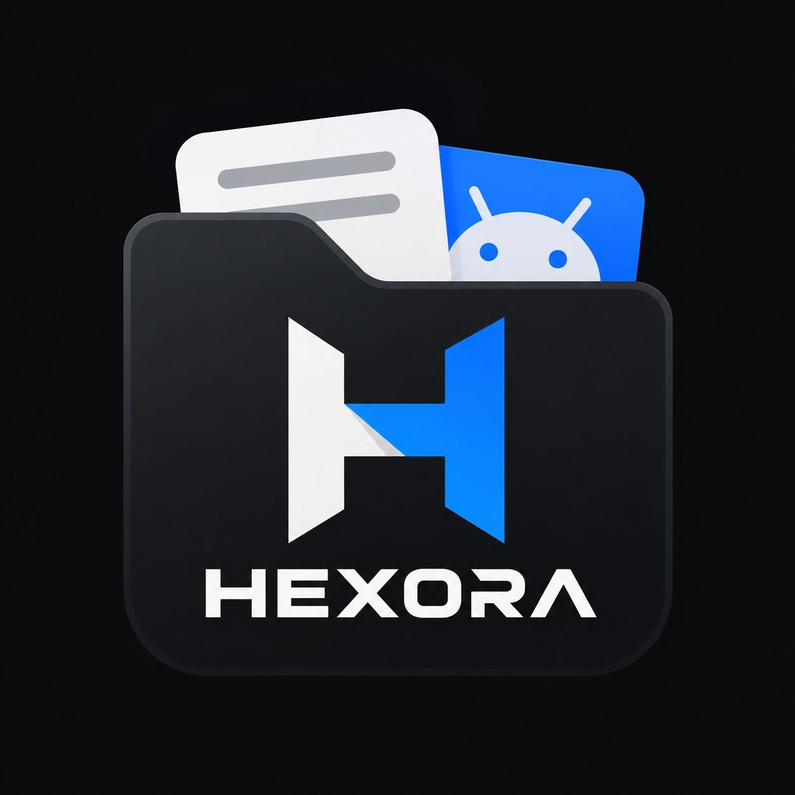
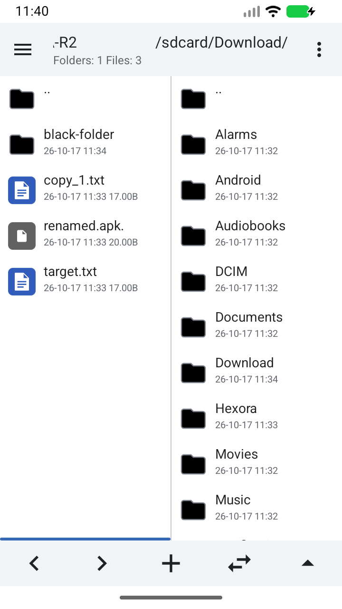
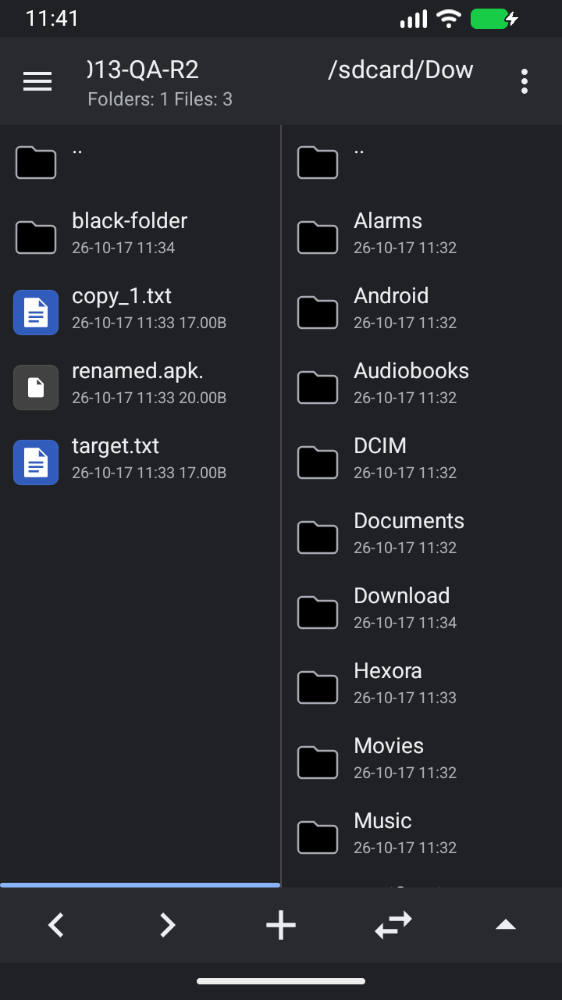

# Hexora



An Android dual-pane file manager with archive browsing, a built-in editor,
and APK tools. Hexora is developed by [ZENIN](https://github.com/ZENINXOP),
based on the open-source [MP-Manager](https://github.com/AbdurazaaqMohammed/MP-Manager).

[Repository](https://github.com/ZENINXOP/Hexora) ·
[Releases](https://github.com/ZENINXOP/Hexora/releases) ·
[Report an issue](https://github.com/ZENINXOP/Hexora/issues) ·
[Telegram channel](https://t.me/Hexora_x)

**Latest release:** [Hexora 0.1.3](https://github.com/ZENINXOP/Hexora/releases/tag/v0.1.3) ·
[Download signed APK](https://github.com/ZENINXOP/Hexora/releases/download/v0.1.3/Hexora.0.1.3.apk) ·
[Changes from 0.1.2](docs/releases/0.1.3.md)

Version 0.1.3 updates 0.1.2 in place using package `com.hexora.zenin` and the
same signing certificate. Version 0.1.1 uses a separate package; its private
preferences, folder grants and editor sessions remain separate.

## Screenshots

<p align="center">
  
  
</p>

Captured from the signed Hexora 0.1.3 release on an isolated Android 16 QA
emulator on October 17, 2026. Only disposable sample files are shown.

## Features

- Two file panes with independent navigation, bookmarks, history, filtering,
  sorting, and multi-selection.
- ZIP and APK browsing, file editing inside archives, compression, and extraction.
- Text, XML, Smali, DEX, and resource tools, plus APK information and installation.
- Built-in image viewing and audio/video playback.
- Root and Shizuku support for locations requiring elevated access.
- Light, dark, black, and system themes, with configurable file rows and menus.
- Telegram/shared attachment imports, split-APK bundle merging, and a script
  console with arguments, input, Stop and timeout controls.
- Local file clipboard, password-protected ZIP browsing/editing, and archive
  filename/content search.
- DEX class import/rename, package rename and original/current comparisons;
  JVM bytecode inspection and read-only Java decompilation.

## ZIP files

Tap a ZIP to browse its folders. Long-press a ZIP and choose **Extract ZIP**
to unpack it into a new folder beside the archive. If that folder name already
exists, Hexora chooses an unused name rather than merging into it.

The current source indexes archive folders once and reuses parsed headers for
navigation and file opening. Archive reads and XML resource parsing run in the
background. Cached metadata is refreshed when an archive changes or is manually
refreshed. ZIP regression tests cover folder navigation, repeated reads,
concurrent pane requests, and cache invalidation.

## Building

Use **JDK 17**, the included **Gradle 8.13** wrapper, and Android SDK platform 36.
In Android Studio, select JDK 17 as the **Gradle JDK**. Java 25 is incompatible
with this project's Gradle version.

Set `sdk.dir` in an untracked `local.properties`, then run:

```sh
./gradlew :app:assembleDebug
```

Application ID: `com.hexora.zenin`. The upstream Java namespace is retained
for source and extension compatibility. Hexora uses its own preferences,
provider authorities, and export directory.

## Local QA

The native MuMu regression runner and instructions are in [qa/README.md](qa/README.md).
Coverage, fixes, evidence, and remaining limitations are recorded in
[qa/REPORT.md](qa/REPORT.md). Generated QA APKs and emulator artifacts stay local;
they are separate from the published release linked above.

Bundled LSPatch runtime provenance and its pinned recursive corresponding
source are available in [third_party/lspatch](third_party/lspatch/README.md).
Build and emulator validation for the published release are recorded in
[the release notes](docs/releases/0.1.3.md). Historical QA reports retain their
original source-only status and failed attempts where applicable.

The updater checks this repository's GitHub releases. Release APK filenames
start with `Hexora.`. Downloadable tool packs and their signed catalog are
published with the same release and use Hexora's signing certificate.

## Contributors

- **ZENIN / ZENINXOP** — Hexora project owner.
- **OpenAI Codex** — AI-assisted UI, branding, and performance development.

See [CONTRIBUTORS.md](CONTRIBUTORS.md) for the Hexora contributor list.

## License and upstream notices

Hexora retains the upstream [GPL-3.0 license](LICENSE) and
[attribution notices](UPSTREAM_NOTICES.md). Further background and feature
documentation are available in the [upstream project](https://github.com/AbdurazaaqMohammed/MP-Manager).
